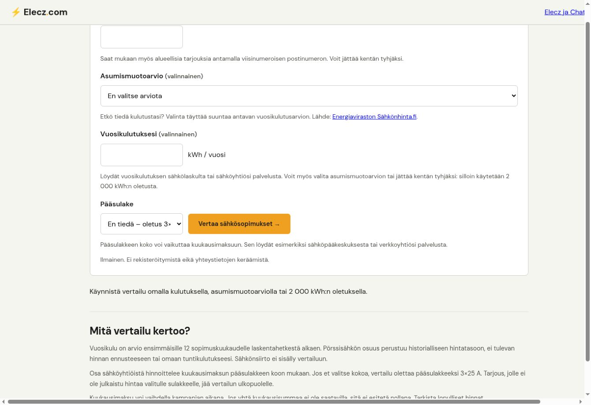
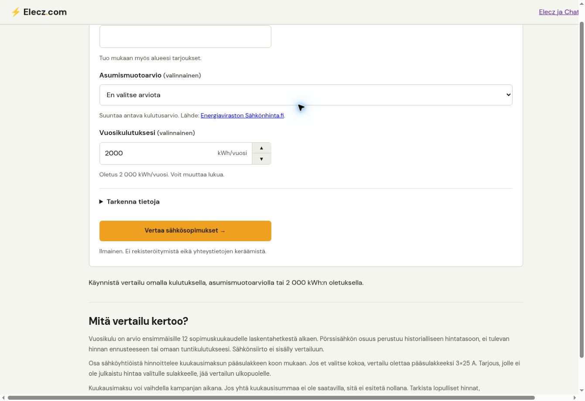
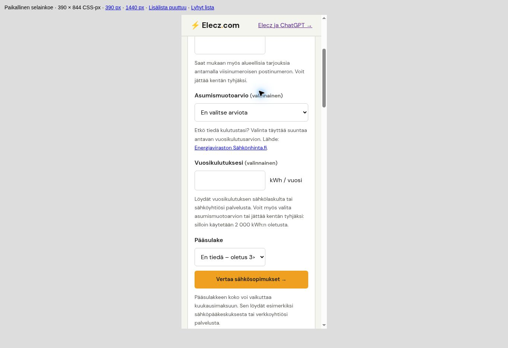
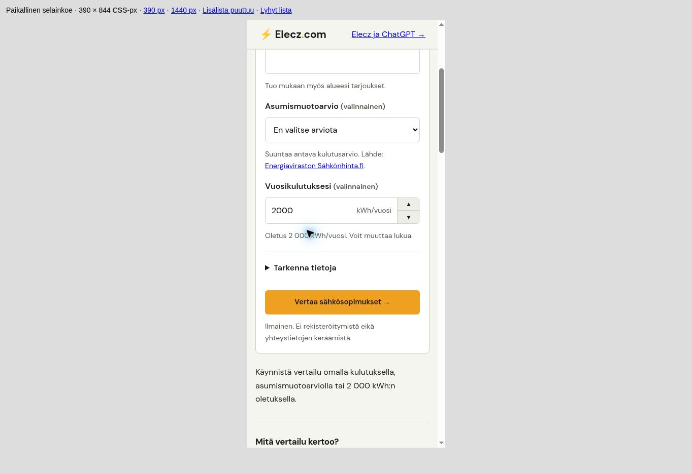

# FI-lomakkeen siistiminen – rajaus ja selainkoe 30.10.2026

Pohja: Pages main `3395527069523d87be7952d141bf673050876fed`.
Muutos koskee vain FI-vertailun HTML:ää, selaimen käyttöliittymätilaa ja testejä.
Coreen, Contractsiin, MCP:hen, Workeriin, API-kenttiin tai tarjousjärjestykseen ei tehdä muutoksia.

## Rajaus

- Pääsulake siirtyy aluksi suljettuun natiiviin **Tarkenna tietoja** -kohtaan. Muu kohde -valinta tai palautettu sulakevalinta avaa kohdan. Käyttäjä voi avata ja sulkea sen näppäimistöllä. Sulakeoletuksen tulosteksti säilyy.
- Vertaa-painike on omalla rivillään lomakkeen lopussa, mobiilissa koko kentän levyinen. Postinumero, kulutus ja sulake ovat samalla enintään 400 px leveydellä. Asumismuotovalikko käyttää tilaa pitkille vaihtoehdoille.
- Ohjeita lyhennetään. Sulakkeen koko oletusteksti mahtuu näkyviin. Kulutuslukujen tuhaterottimet ja tuloksen yksikkö sidotaan katkeamattomilla välilyönneillä.
- Aloitusarvo on Sakarin pyynnöstä näkyvä **2000 kWh**. Koskemattomana se lähettää vanhan oletuspyynnön ilman kulutuslukua ja tulos kertoo Oletuskulutus. Klikkaus/fokus yksin ei muuta alkuperää.
- Omat ylä-/alanuolipainikkeet ja näppäimistön ylös/alas muuttavat lukua **tasan 1000 kWh**: 2000 → 3000, 5500 → 6500. Muutos merkitään omaksi kulutukseksi. Tarkka oma kokonaisluku, kuten 6789, on edelleen sallittu. Alanuoli ei tee luvusta nollaa tai negatiivista.
- Asumismuotoarvio lähettää edelleen vain `housing_profile`-tunnisteen. Luvun muokkaus tyhjentää profiilin ja lähettää vain kulutusluvun. Muu kohde ei saa keksittyä arviota.
- Takaisin-painiketta varten saman selaushistoriamerkinnän `history.state` sisältää vain kulutuskentän arvon, profiilivalinnan ja alkuperän. Muut history.state-avaimet säilyvät. Palautus tarkistaa yhdistelmän ja palauttaa kentät yhdessä; tuntematonta profiilia ei esitetä arviona. LocalStoragea tai uusia verkkokutsuja ei käytetä.
- Nollan tarjouksen ryhmä näyttää nykyisen ei tarjouksia -ilmoituksen, ilman Yhteensä 0 tarjousta -laskuria.

## Tarkistus

- `node --test tests/fi-more-offers.cjs tests/fi-housing-profiles.cjs tests/fi-postcode.cjs tests/fi-main-fuse.cjs tests/fi-comparison-links.cjs tests/fi-price-periods.cjs tests/worker-go-redirects.cjs`: **91 hyväksyttyä, 0 hylättyä, 0 ohitettua**. Vanhan sarjan 81 lisäksi 10 uutta käyttäytymistestiä; vanhoja väitteitä päivitetty tarkoituksellisen näkyvän oletuksen, details-kohdan ja nollalaskurin osalta.
- Kahdeksan aiemmin tuotannon Coresta tallennettua todellista vastausta: oma luku, oletus, sähkölämmitysoletus, neljä asumismuotoprofiilia sekä postinumero/sulake. Jokaiselle ajettiin kolme sivun vastaustarkistusta: **24 hyväksyttyä tarkistusta**. Vastaukset ovat saman päivän otoksia, eivät uusi tuotantojulkaisu.
- `node --check fi/sahkosopimukset/comparison.js` ja `git diff --check`: hyväksytty.
- Oma Chrome-selainkoe paikallisella lähdekoodilla ja yllä mainituilla Core-vastausotoksilla. Responsiivinen näkymä testattiin **390 × 844** ja **1440 × 1000 CSS-px iframeissa**, ei fyysisillä puhelimilla. Sisäsivujen clientWidth/scrollWidth olivat 375/375 ja 1425/1425: ei vaakaylivuotoa. Kuorien vierityspalkit kuuluvat testikehykseen.
- Postinumero/kulutus/painike mobiilissa 305 px; postinumero/kulutus työpöydällä 400 px. Sulakkeen oletusteksti näkyy kokonaisena 400 px kentässä.
- Nuolipainike 2000 → 3000 ja profiilin 5500 → 6500 näppäimistöllä: arvoksi tulee oma kulutus, profiili tyhjenee. Natiivi kokonaislukuvalidointi sallii tarkan oman luvun (`step=1`); näkyvät nuolet hoitavat 1000 kWh lisäyksen ilman selaimen step-pyöristystä.
- Muu kohde avaa sulakkeen ja tyhjentää geneerisen oletuksen. Mobiilissa oma 6000 + 67100 + 3×35 palautti oikean oman kulutuksen otsikon ja sulaketekstin, eikä postinumerovaroitusta näkynyt.
- Toiselle sivulle siirtyminen ja selaimen takaisin-painike säilyttivät 5500 kWh pientaloprofiilin ja arvioalkuperän; uusi vertailu palautti vastaavan Arvio-otsikon.
- Näytä lisää avasi edelleen 20 pörssitarjousta. Erillisellä tyhjän ryhmän testivastauksella oletusotsikko näkyi, mutta molemmat nollalaskurit olivat tyhjiä ja piilotettuja.

## Ennen / jälkeen

Kuvat ovat alkuperäisiä selaimen viewport-kuvia. Niissä näkyvä harmaa alue ja 390/1440 px otsikko ovat paikallista testikehystä. Työpöydän testikehys on kuvakaappausikkunaa leveämpi; sivun sisäinen vaakaylivuoto tarkistettiin erikseen.

### Työpöytä ennen

### Työpöytä jälkeen

### Mobiili ennen

### Mobiili jälkeen

## Julkaisu

Tämä on katselmoitava PR. Ei mergeä eikä tuotantojulkaisua tässä vaiheessa. Haaran commitissa on `[CF-Pages-Skip]`, jotta automaattinen esikatselujulkaisu ei käynnisty. Jos PR myöhemmin hyväksytään julkaistavaksi, käytetään tavallista merge-committia ilman skip-merkintää, ei squashia.
